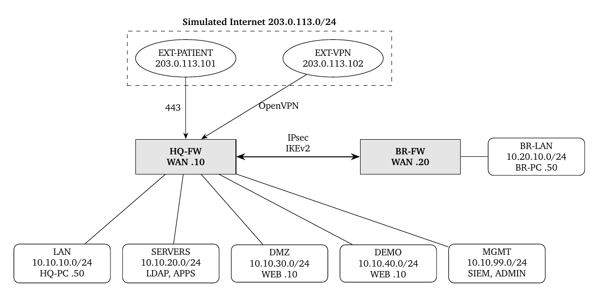

# Defense-in-Depth Medical Lab

**Secure, segmented network infrastructure for a medical appointment booking platform. A fully virtualized lab (proof of concept).**

Nowadays, protecting health data has become a major concern for any online service. That is why this project secures the network of a fictitious medical appointment platform spread across two sites. It was built from end to end in VMware Workstation, around two OPNsense firewalls, an LDAP directory, a reverse proxy, an IPS and a SIEM. The goal was not to rebuild a full production system, but to show that each security requirement is answered by the simplest control that really satisfies it, and that the whole thing stays verifiable.

> Lab proof of concept. All data is fictitious, addresses use documentation and private ranges (203.0.113.0/24 is TEST-NET-3, 10.0.0.0/8 is private), and no real secret is included. The lab domain is mediconnect.lab.

## Overview

The platform serves several populations that do not share the same needs, nor the same level of trust : patients who browse a public portal, doctors who reach an authenticated professional area, remote employees split into five business groups, a sales team, and the administrators who operate everything. Consequently, security cannot come down to a single firewall. It is spread across the architecture, the identity of each user, and the logging of what happens.

**Tech stack :**

| Area | Technology |
|---|---|
| Firewalls | OPNsense (one per site) |
| Site-to-site VPN | IPsec IKEv2 (pre-shared key) |
| Remote access VPN | OpenVPN (client certificate and LDAP) |
| Identity | OpenLDAP (groups are the business profiles) |
| Reverse proxy and web | Nginx (TLS, mutual TLS, rate limiting) |
| PKI | Internal CA managed by OPNsense |
| Intrusion prevention | Suricata IPS (ET Open and OPNsense-App-detect) |
| Monitoring and SIEM | Wazuh (agents and custom rules) |

## Architecture

The infrastructure is made of twelve virtual machines, spread across the headquarters, a branch site, and a simulated Internet. Each zone is an isolated VMware segment, connected to the others only through the firewall. Consequently, isolation is obtained by construction and not by VLAN tagging.



### Zones and trust levels

Every zone gets a trust level, from the least to the most critical. Any flow that climbs toward a more sensitive level has to be justified by an explicit rule. Everything else is denied and logged :

| Zone | Trust level | General rule |
|---|---|---|
| Internet | 0, untrusted | Nothing inbound except 443 toward the DMZ and the VPN |
| DMZ | 1, exposed | Cannot initiate anything toward the inside, except its logs to the SIEM |
| Demo | 1, isolated | No link with production, nor with real data |
| Branch LAN | 3, remote internal | Limited access to business resources through the tunnel |
| HQ LAN | 3, internal | Internet egress and targeted resources, no administration |
| Servers | 4, sensitive | Reachable only from authorized flows |
| Management | 5, critical | Reachable only by the administrators |

## Security design

The design follows a few deliberate choices :
- **Deny by default, log everything.** Each interface denies all traffic, then only the required flows are allowed. That way, a missing rule becomes a visible block, and never an accidental allow.
- **Defense in depth.** A connection has to pass the central firewall, then the local nftables firewall of the host, then, for SSH, the key-only policy of the server. Consequently, one mistake on a single layer is not enough to open an access.
- **Identity-driven filtering.** Each remote user gets a fixed VPN address inside the subnet of his group. The firewall recognizes the user by that address and applies the matching rules.
- **Strong authentication where it matters.** Doctors authenticate with a client certificate and a password (two factors). Remote users combine a client certificate with their LDAP credentials. The site-to-site tunnel uses IPsec IKEv2.
- **Separated administration.** The firewall GUI only listens on the management zone, SSH is key-only with named accounts, and administration never shares a path with the user traffic.

## Filtering policy

Main matrix between zones, read from the source row toward the destination column. `x` means denied and logged :

| Source / Dest | Internet | DMZ | Demo | LAN | Servers | MGMT |
|---|:---:|:---:|:---:|:---:|:---:|:---:|
| **Internet** | | 443 | x | x | x | x |
| **DMZ** | updates | | x | x | x | logs |
| **Demo** | x | x | | x | x | logs |
| **LAN** | web | x | x | | identity | x |
| **Servers** | updates | x | x | x | | logs |
| **MGMT** | updates | 22 | 22 | x | 22 | |
| **Branch LAN** | via BR | x | x | x | identity | x |

Here, "logs" means 1514/1515 toward the SIEM only, and "identity" means the per-user rules below.

### Identity-based rules

| Group (VPN subnet) | Allowed | Denied |
|---|---|---|
| Support (10.8.0.16/28) | Support app (.22) | everything else |
| Accounting (10.8.0.32/28) | Accounting server (.23) | everything else |
| Employees (10.8.0.48/28) | Office resources (.24) | everything else |
| IT (10.8.0.64/28) | Tech resource (.25 on 22 and 443), SSH to servers | firewalls, management |
| Admins (10.8.0.80/28) | Full management zone (GUI, SIEM, SSH) | |
| Sales (10.8.0.96/28) | CRM (.21) and demo zone | production, management |

## Monitoring

All hosts send their logs to Wazuh through an authenticated and encrypted agent channel (TCP 1514), explicitly allowed only toward the SIEM. Three kinds of security events are put forward by custom rules :
- **VPN authentication failures**, with a brute-force alert triggered from three failures in 120 seconds.
- **SSH attempts with a denied account**, caught on the server side.
- **File integrity monitoring** on the web tree, which flags any added or changed file.

Additionally, Suricata runs inline (IPS) on the central firewall. It blocks a curated subset of ET Open signatures (scans, web attacks, exploitation) and, with the OPNsense-App-detect ruleset, it blocks disallowed applications such as social media on the LAN-to-Internet traffic.

## Testing

The lab is validated by a reproducible campaign (T01 to T20), driven by two scripts, tcheck.sh and vpn-test.sh, that assert which accesses have to succeed and which ones have to be refused. A run is conformant only when every expected result matches the obtained one.

| Theme | What is checked |
|---|---|
| Exposure (T01 to T05) | Portal over HTTPS, HTTP redirect, doctor area needs a certificate, no internal access from the Internet |
| Interconnection (T07, T08) | The branch reaches its allowed resources, and nothing else |
| Identity (T09 to T14) | Each VPN group reaches only its own profile |
| Administration (T16) | A LAN host cannot reach the firewall GUI, nor SSH the servers |
| Isolation (T06, T17) | The DMZ and the demo cannot reach the inside, nor production |
| Detection (T15, T18 to T20) | Failed VPN logins, blocked apps and scans raise correlated alerts |

## Limitations

This is a lab, and it is worth being honest about it :
- No high availability (one firewall per site, a single host). A hardware failure stops everything.
- No VLAN. Segment isolation fits a lab, although a physical network would use VLANs.
- Simulated Internet, and an internal CA instead of public certificates.
- Applications are static pages, so there is no real application-layer testing (e.g. a full web application firewall).
- On the LAN and the branch, identity relies on the subnet and not on the user.
- The doctor MFA pairs a certificate and a password, although the two are not bound together, and no TOTP is deployed.
- IPsec uses a pre-shared key, so there is no per-peer revocation.

## Repository layout

```
defense-in-depth-medical-lab/
  README.md            you are here
  docs/                architecture details and a sanitized build guide
  configs/             nginx, nftables, sshd and Wazuh rules
  report/              full written report, with evidence screenshots (PDF)
```

The docs folder holds the step-by-step build notes, for anyone who wants to reproduce the lab. The full report covers the same ground in depth, and it is where the screenshots live.

---

*Built as a hands-on network security project. Tools: OPNsense, OpenLDAP, nginx, Suricata, Wazuh, StrongSwan, OpenVPN.*
